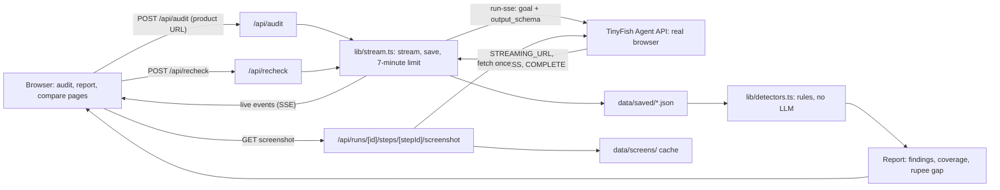
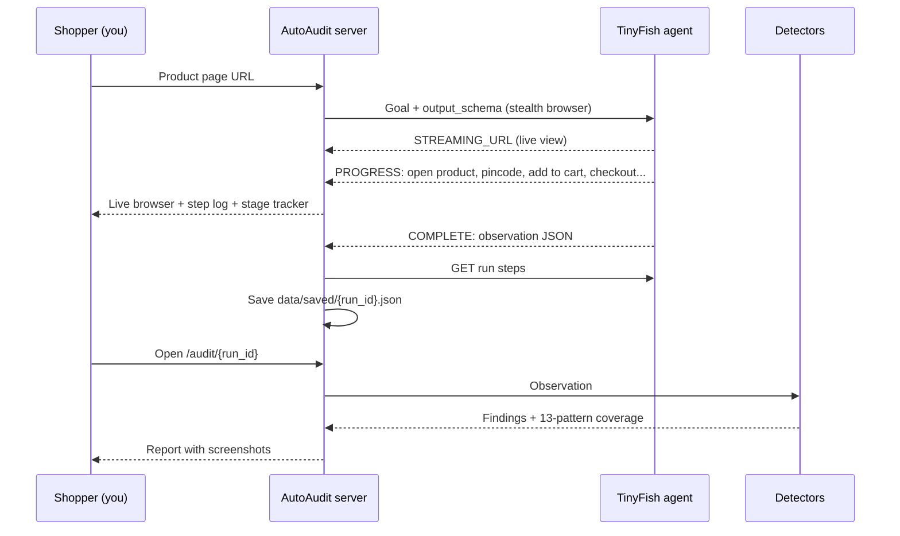

# AutoAudit

**The price you chose is not the price you pay.** AutoAudit sends a TinyFish browser agent through an Indian online store's checkout as a guest shopper, stops before payment, and reports the dark patterns it saw: fees that appeared after the product was chosen, items added without asking, countdowns that restart, and checkouts that hide the final price behind an OTP. Each finding carries the rupee amount, a quote, and the screenshot of the step.

## Why it exists

India's Central Consumer Protection Authority bans 13 dark patterns under the *Guidelines for Prevention and Regulation of Dark Patterns, 2023*. It fined Zepto ₹7 lakh after a manual "reality test" found a ₹170 kajal became ₹177.44 in the cart, and in August 2026 it penalised nine more platforms. From **1 January 2027**, the Consumer Protection (E-Commerce) (Amendment) Rules, 2026 require every e-commerce entity to self-audit for dark patterns every year.

Most of these patterns live in the cart and checkout, behind clicks, pincodes, and popups. A page scraper never reaches them. A browser agent does.

## How it works

1. **The agent observes.** One TinyFish run opens the product page, enters pincode 560037, adds one unit, opens the cart, and checks out as a guest with dummy details. It stops at the payment screen, or at an OTP, login, or captcha, and never submits a phone number to an OTP screen. It returns plain facts in a fixed `output_schema`: prices, fee lines with the stage each first appeared, cart items, pre-selected options, decline wording, and urgency claims.
2. **The code judges.** `lib/detectors.ts` applies deterministic rules to those facts. No model decides what counts as a dark pattern, so every finding is reproducible.
3. **The evidence is attached.** Each finding is matched to the agent's step screenshot. Screenshots are cached in `data/screens/` so saved reports keep their proof.
4. **Fresh-session recheck.** For countdown timers, a second run visits as a new shopper. A timer that shows more time than it should have left is reported as restarted.

| Detector | Rule | CCPA pattern |
| --- | --- | --- |
| Hidden fee | A fee that first appears after the product page, and whose amount was not shown there | Drip pricing |
| Sneaked item | A paid cart item the shopper did not add, or a paid option already selected | Basket sneaking |
| Restarting countdown | A fresh session shows more time left than the first visit allows | False urgency |
| Urgency claim | A countdown or scarcity claim not yet rechecked (for review) | False urgency |
| OTP or login wall | Checkout needs a phone OTP or login before the order summary (for review) | Forced action |
| Guilt wording | Opt-out text like "No, I'll take the risk" (for review) | Confirm shaming |
| Pre-ticked consent | Marketing or WhatsApp consent ticked by default (for review) | Interface interference |

The report lists all 13 patterns as found, for review, not found, or not checked, so a clean result is never overstated.

## Architecture

One Next.js app. TinyFish does the shopping, AutoAudit's own code does the judging, and results are saved as files.



### One audit, end to end



### The main design rule: the agent observes, the code judges

- **The agent observes.** The goal in `lib/journey.ts` asks for facts only. The `output_schema` forces a fixed shape: the listed price, fee lines with the stage each first appeared, cart items with `added_by_shopper`, pre-selected options, decline wording, urgency claims, the furthest stage reached, and what blocked the run. Missing values are `null`, never guessed.
- **The code judges.** `lib/detectors.ts` is a set of pure functions: one observation in, findings out. The same observation always gives the same findings, and each one can be explained in one sentence.
- **Proof comes from TinyFish.** `lib/evidence.ts` matches each finding to the agent step for that stage. The screenshot route fetches the image from TinyFish once and caches it.

### Data

| Data | Where | Shape |
| --- | --- | --- |
| Observation | `COMPLETE.result` from TinyFish | `Observation` in `lib/types.ts` |
| Saved audit | `data/saved/{run_id}.json` | `SavedRun`: URL, timings, progress, steps, observation, recheck |
| Finding | Built on every page load | `pattern`, `severity` (high, medium, review), `title`, `summary`, `amount_inr`, `quote`, `stage` |
| Coverage | Built on every page load | Each of 13 patterns: found, review, not found, or not checked |
| Screenshots | `data/screens/{run_id}/{step_id}.jpg` | JPEG, cached on first view |

### Safety and cost control

- The TinyFish key lives only on the server, in `.env.local`.
- The agent never pays, never enters card or UPI details, never creates an account, and never submits a phone number to an OTP screen.
- Runs are cancelled on TinyFish when the browser disconnects, when the user clicks Cancel, or after 7 minutes on the server.
- Saved audits reopen without spending credits.

### Stack

- Next.js 15 (App Router), React 19, TypeScript, Tailwind CSS
- TinyFish Agent API over `fetch`, with Server-Sent Events (SSE) parsed by hand
- No database: JSON files and cached screenshots
- No LLM on our side: the only model is the TinyFish agent doing the browsing

## Where TinyFish fits

| TinyFish API | Used for |
| --- | --- |
| `POST /v1/automation/run-sse` | The checkout journey and the recheck, with `output_schema` and the stealth browser profile |
| `STREAMING_URL` event | The live browser shown while an audit runs, one per store in compare mode |
| `PROGRESS` events | The step log and the stage tracker |
| `GET /v1/runs/{id}` | Step list and step count for the report |
| `GET /v1/runs/{id}/steps/{stepId}/screenshot` | Evidence screenshots on finding cards |
| `POST /v1/runs/{id}/cancel` | Cancel button, browser disconnects, and a 7-minute server limit |
| Search and Fetch | Finding product pages and vetting stores before spending a run |

## Results from real stores

Audits run on 17 October 2026 from a guest session, pincode 560037:

| Store | Furthest step | What was observed |
| --- | --- | --- |
| Forest Essentials | Payment | ₹595 soap became ₹745 at payment. A ₹150 "Fixed Rate" charge first appeared in the cart. The product page only said free delivery above ₹1,000. |
| Kama Ayurveda | Payment | ₹895 with no added fees. A free sample was added automatically. |
| Beardo | OTP screen | A cart countdown showed 4m 37s left. A fresh session 76 minutes later showed "Offer ends in 04 MINS 59 SECS": the timer restarts for each new visitor. |
| Bombay Shaving Company | OTP screen | "Selling fast — grab yours before they are gone!" and a sale countdown. |
| Chumbak | OTP screen | Checkout asks for a phone number before showing the order summary. |

Each audit takes 3 to 6 minutes and 18 to 54 agent steps.

## Run it locally

```bash
npm install
cp .env.example .env.local   # add TINYFISH_API_KEY
npm run dev
```

Open http://localhost:3000, paste a product page URL, and click **Run audit**. Saved audits in `data/saved/` open at `/audit/{run_id}` without spending credits, and `/compare` ranks every audited store.

## Project layout

```
app/
  page.tsx                     homepage and audit form
  audit/page.tsx               live audit: browser view, stage tracker, step log
  audit/[id]/page.tsx          report
  compare/page.tsx             parallel audits and the ranking
  api/audit/route.ts           starts a checkout journey and streams it
  api/recheck/route.ts         fresh-session countdown recheck
  api/runs/[id]/...            run details and cached step screenshots
lib/
  journey.ts                   goals and output schemas
  detectors.ts                 observations in, findings out
  patterns.ts                  the 13 CCPA patterns
  types.ts                     Observation, Finding, SavedRun, Audit
  tinyfish.ts                  TinyFish API client and SSE parsing
  stream.ts                    streaming, saving, and the run time limit
  saved.ts                     reading and writing saved audits
  audits.ts                    loading and ranking audits
  evidence.ts                  matching findings to step screenshots
  use-run.ts                   browser hook for live run events
components/
  LiveAudit.tsx                live browser, stage tracker, step log
  CompareRunner.tsx            parallel audits on the compare page
  RecheckButton.tsx            fresh-session countdown recheck
  Shot.tsx                     screenshot with a text fallback
data/
  saved/                       finished audits
  screens/                     cached step screenshots
```

## Limits

- AutoAudit reports what one guest journey showed on one date. It is not a legal finding.
- Many Indian brand stores use one-tap OTP checkouts (GoKwik, Shiprocket, Shopflo). The agent stops there, so charges added after the address step are reported as not checked.
- Contact details are dummy values, and the agent never pays or creates an account.
